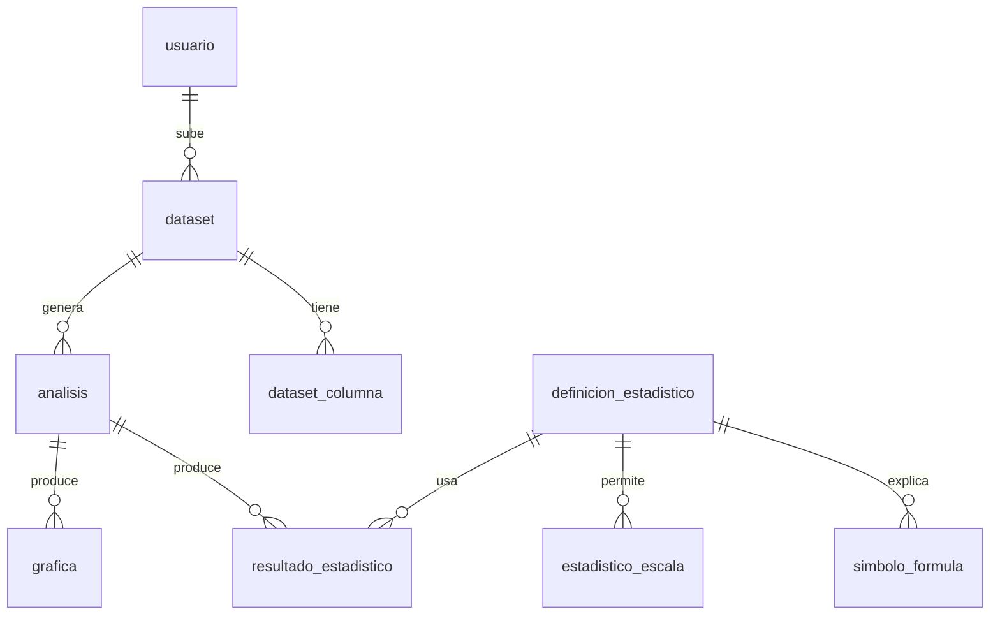

# Plan de base de datos — MVP sólido

**Sistema de estadística visual y didáctica**
Frontend: React · Backend: Node.js · DB: MySQL 8.0+

> **Objetivo del producto:** que una persona que *no* sabe estadística obtenga
> media, mediana, medidas de posición y gráficas — y al pasar el mouse sobre
> cualquier resultado, entienda **qué fórmula se usó, con qué datos y paso a paso**.

---

## 1. Filosofía del diseño

Tres decisiones que mantienen el sistema simple sin perder solidez:

1. **Los datos de la matriz se guardan como JSON**, no celda por celda.
   Los cálculos se hacen en Node (en memoria) y solo se guarda el *resultado*.
   Menos tablas, menos filas, mucho más rápido de programar.

2. **Toda la explicación didáctica vive en 2 sitios:**
   - `definicion_estadistico` → el "qué es" (fórmula, descripción, cuándo usar). Contenido fijo que escribes tú una vez.
   - `resultado_estadistico` → el "cómo salió ESTE número" (fórmula con los valores sustituidos + pasos + datos usados). Se genera en cada cálculo.

3. **Resultados complejos (tablas de frecuencia, caja) se guardan como JSON**
   dentro de `resultado_estadistico`, en vez de tener una tabla por cada tipo.

Resultado: pasamos de **16 tablas a 9**, sin perder nada de lo importante.

---

## 2. Mapa de tablas



| Tabla | Rol | ¿Contenido dinámico? |
|-------|-----|----------------------|
| `usuario` | Cuentas | Sí (usuarios) |
| `dataset` | Matriz de datos (JSON) + origen | Sí |
| `dataset_columna` | Tipo y escala de cada columna | Sí |
| `definicion_estadistico` | Catálogo: qué es cada estadístico | **No (semilla)** |
| `simbolo_formula` | Significado de cada símbolo | **No (semilla)** |
| `estadistico_escala` | Qué escala admite cada estadístico | **No (semilla)** |
| `glosario` | Términos clave | **No (semilla)** |
| `analisis` | Una ejecución de cálculos sobre un dataset | Sí |
| `resultado_estadistico` | El número + su explicación (hover) | Sí |
| `grafica` | Config de cada gráfica (JSON) | Sí |

*Las 4 tablas "semilla" las llenas tú una vez con los estadísticos que soportes
(media, mediana, moda, cuartiles, rango, desviación, etc.).*

---

## 3. Datos de usuario y matriz

### `usuario`
```sql
CREATE TABLE usuario (
  id          BIGINT UNSIGNED AUTO_INCREMENT PRIMARY KEY,
  correo      VARCHAR(190) NOT NULL UNIQUE,
  nombre      VARCHAR(120) NOT NULL,
  hash_clave  VARCHAR(255) NOT NULL,
  creado_en   TIMESTAMP DEFAULT CURRENT_TIMESTAMP
) ENGINE=InnoDB DEFAULT CHARSET=utf8mb4;
```

### `dataset`
La matriz completa se guarda en `datos_json`. Sirve tanto para Excel importado
como para tablas creadas en la app.

```sql
CREATE TABLE dataset (
  id          BIGINT UNSIGNED AUTO_INCREMENT PRIMARY KEY,
  usuario_id  BIGINT UNSIGNED NOT NULL,
  titulo      VARCHAR(200) NOT NULL,
  origen      ENUM('excel','csv','manual') DEFAULT 'manual',
  n_filas     INT UNSIGNED DEFAULT 0,
  n_columnas  SMALLINT UNSIGNED DEFAULT 0,
  datos_json  JSON NOT NULL,          -- las celdas (ver contrato abajo)
  avisos_json JSON,                   -- incidencias de importación (opcional)
  creado_en   TIMESTAMP DEFAULT CURRENT_TIMESTAMP,
  actualizado_en TIMESTAMP DEFAULT CURRENT_TIMESTAMP ON UPDATE CURRENT_TIMESTAMP,
  FOREIGN KEY (usuario_id) REFERENCES usuario(id) ON DELETE CASCADE,
  INDEX idx_dataset_usuario (usuario_id, creado_en)
) ENGINE=InnoDB DEFAULT CHARSET=utf8mb4;
```

**Formato de `datos_json`** (orientado a filas):
```json
{
  "columnas": ["edad", "ciudad"],
  "filas": [
    [23, "Madrid"],
    [31, "Lima"],
    [28, "Bogotá"]
  ]
}
```

> **Regla práctica de tamaño:** JSON en MySQL va perfecto para datasets de hasta
> unos pocos MB (miles de filas), que es el caso típico de un usuario educativo.
> Si algún día necesitas datasets enormes, se guarda el archivo en storage
> (disco/S3) y en `datos_json` solo una muestra + la ruta. No lo necesitas ahora.

### `dataset_columna`
Se mantiene como tabla (no JSON) porque **de aquí depende qué cálculos ofreces**:
no tiene sentido calcular una media sobre una columna nominal. Es el cerebro que
evita que el usuario "se amargue" con cálculos que no aplican.

```sql
CREATE TABLE dataset_columna (
  id          BIGINT UNSIGNED AUTO_INCREMENT PRIMARY KEY,
  dataset_id  BIGINT UNSIGNED NOT NULL,
  posicion    SMALLINT UNSIGNED NOT NULL,   -- índice de columna en datos_json
  nombre      VARCHAR(150) NOT NULL,
  tipo_dato   ENUM('numerico','texto','fecha','booleano','mixto') NOT NULL,
  escala      ENUM('nominal','ordinal','intervalo','razon') NOT NULL,
  naturaleza  ENUM('discreta','continua','na') DEFAULT 'na',
  unidad      VARCHAR(40),
  decimales   TINYINT UNSIGNED DEFAULT 2,
  n_validos   INT UNSIGNED DEFAULT 0,
  n_nulos     INT UNSIGNED DEFAULT 0,
  UNIQUE KEY uq_col (dataset_id, posicion),
  FOREIGN KEY (dataset_id) REFERENCES dataset(id) ON DELETE CASCADE
) ENGINE=InnoDB DEFAULT CHARSET=utf8mb4;
```

---

## 4. Catálogo didáctico (contenido semilla)

Esto lo llenas tú una vez. Es lo que hace que la app "enseñe".

```sql
CREATE TABLE definicion_estadistico (
  id                SMALLINT UNSIGNED AUTO_INCREMENT PRIMARY KEY,
  clave             VARCHAR(50) NOT NULL UNIQUE,     -- 'media', 'mediana'...
  nombre            VARCHAR(120) NOT NULL,
  categoria         ENUM('tendencia_central','posicion','dispersion','forma','frecuencia','asociacion') NOT NULL,
  formula_latex     TEXT NOT NULL,                   -- render con KaTeX en React
  formula_texto     VARCHAR(300),
  descripcion       TEXT NOT NULL,                   -- explicación simple
  cuando_usar       TEXT,
  malinterpretacion TEXT,                            -- "cuidado con..."
  requiere_ordenado BOOLEAN DEFAULT FALSE,
  requiere_agrupado BOOLEAN DEFAULT FALSE
) ENGINE=InnoDB DEFAULT CHARSET=utf8mb4;

CREATE TABLE simbolo_formula (
  id            INT UNSIGNED AUTO_INCREMENT PRIMARY KEY,
  definicion_id SMALLINT UNSIGNED NOT NULL,
  simbolo_latex VARCHAR(60) NOT NULL,     -- "\\bar{x}"
  significado   VARCHAR(250) NOT NULL,    -- "la media de los datos"
  orden         TINYINT DEFAULT 0,
  FOREIGN KEY (definicion_id) REFERENCES definicion_estadistico(id) ON DELETE CASCADE
) ENGINE=InnoDB DEFAULT CHARSET=utf8mb4;

CREATE TABLE estadistico_escala (
  definicion_id SMALLINT UNSIGNED NOT NULL,
  escala        ENUM('nominal','ordinal','intervalo','razon') NOT NULL,
  permitido     BOOLEAN DEFAULT TRUE,
  motivo        VARCHAR(250),            -- por qué sí o por qué no
  PRIMARY KEY (definicion_id, escala),
  FOREIGN KEY (definicion_id) REFERENCES definicion_estadistico(id) ON DELETE CASCADE
) ENGINE=InnoDB DEFAULT CHARSET=utf8mb4;

CREATE TABLE glosario (
  id         INT UNSIGNED AUTO_INCREMENT PRIMARY KEY,
  termino    VARCHAR(80) NOT NULL UNIQUE,
  definicion TEXT NOT NULL,
  ejemplo    TEXT
) ENGINE=InnoDB DEFAULT CHARSET=utf8mb4;
```

> **Consejo:** puedes empezar con estas 4 tablas como un archivo `catalogo.json`
> en el repo y cargarlo a la DB con un script de seed. Así versionas el contenido
> educativo con Git.

---

## 5. Cálculos y resultados — el corazón del hover

### `analisis`
Agrupa los cálculos que se hicieron sobre un dataset en un momento dado.

```sql
CREATE TABLE analisis (
  id          BIGINT UNSIGNED AUTO_INCREMENT PRIMARY KEY,
  dataset_id  BIGINT UNSIGNED NOT NULL,
  usuario_id  BIGINT UNSIGNED NOT NULL,
  nombre      VARCHAR(150),
  filtros_json JSON,                   -- si el usuario filtró filas
  creado_en   TIMESTAMP DEFAULT CURRENT_TIMESTAMP,
  FOREIGN KEY (dataset_id) REFERENCES dataset(id) ON DELETE CASCADE,
  FOREIGN KEY (usuario_id) REFERENCES usuario(id) ON DELETE CASCADE
) ENGINE=InnoDB DEFAULT CHARSET=utf8mb4;
```

### `resultado_estadistico`
Un resultado por cálculo. `valor_num` para números simples; `valor_json` para
resultados estructurados (tabla de frecuencias, resumen de caja). Los campos
`sustitucion`, `pasos` y `datos_usados` son **lo que muestra el hover**.

```sql
CREATE TABLE resultado_estadistico (
  id            BIGINT UNSIGNED AUTO_INCREMENT PRIMARY KEY,
  analisis_id   BIGINT UNSIGNED NOT NULL,
  columna_id    BIGINT UNSIGNED NOT NULL,
  columna_b_id  BIGINT UNSIGNED NULL,        -- para asociación (2 columnas)
  definicion_id SMALLINT UNSIGNED NOT NULL,
  parametro     DECIMAL(6,3) NULL,           -- ej. percentil 25
  valor_num     DOUBLE NULL,                 -- resultado simple
  valor_txt     VARCHAR(255) NULL,           -- ej. moda de texto
  valor_json    JSON NULL,                   -- resultado estructurado
  n_usado       INT UNSIGNED,
  sustitucion   JSON,                        -- fórmula con valores (hover)
  pasos         JSON,                        -- paso a paso (hover)
  datos_usados  JSON,                        -- qué datos entraron (hover)
  calculado_en  TIMESTAMP DEFAULT CURRENT_TIMESTAMP,
  FOREIGN KEY (analisis_id) REFERENCES analisis(id) ON DELETE CASCADE,
  FOREIGN KEY (definicion_id) REFERENCES definicion_estadistico(id)
) ENGINE=InnoDB DEFAULT CHARSET=utf8mb4;
```

> Quité la restricción `UNIQUE` compleja del diseño original: daba problemas con
> valores NULL y no aporta en un MVP. Si quieres evitar recálculos, lo manejas en
> Node comprobando antes de insertar.

### `grafica`
```sql
CREATE TABLE grafica (
  id           BIGINT UNSIGNED AUTO_INCREMENT PRIMARY KEY,
  analisis_id  BIGINT UNSIGNED NOT NULL,
  tipo         ENUM('histograma','poligono','ojiva','caja','barras','pastel','dispersion','tallo_hoja') NOT NULL,
  columna_id   BIGINT UNSIGNED NULL,
  columna_b_id BIGINT UNSIGNED NULL,
  config_json  JSON,                    -- datos + opciones para Recharts/Chart.js
  creada_en    TIMESTAMP DEFAULT CURRENT_TIMESTAMP,
  FOREIGN KEY (analisis_id) REFERENCES analisis(id) ON DELETE CASCADE
) ENGINE=InnoDB DEFAULT CHARSET=utf8mb4;
```

---

## 6. Contrato JSON del hover (lo más importante)

Esto es lo que Node escribe y React lee para mostrar la explicación. Definirlo
bien **ahora** te ahorra dolores después. Ejemplo real: **la media** de la
columna "edad" con datos `[23, 31, 28]`.

**`sustitucion`** — la fórmula con los números puestos:
```json
{
  "formula_latex": "\\bar{x} = \\frac{\\sum x_i}{n}",
  "variables": { "\\sum x_i": 82, "n": 3 },
  "resultado": 27.33
}
```

**`pasos`** — el paso a paso legible:
```json
[
  { "orden": 1, "texto": "Suma todos los valores", "expresion": "23 + 31 + 28", "resultado": 82 },
  { "orden": 2, "texto": "Cuenta cuántos valores hay", "resultado": 3 },
  { "orden": 3, "texto": "Divide la suma entre la cantidad", "expresion": "82 / 3", "resultado": 27.33 }
]
```

**`datos_usados`** — de dónde salió (para resaltar celdas en la tabla):
```json
{
  "columna": "edad",
  "filas": [0, 1, 2],
  "valores": [23, 31, 28],
  "excluidos": []
}
```

Con estos tres campos + el `join` a `definicion_estadistico`/`simbolo_formula`,
el tooltip de React puede mostrar: **la fórmula bonita (KaTeX), qué significa
cada símbolo, los números sustituidos, los pasos y qué celdas se usaron.** Justo
el objetivo del producto.

Ejemplo de resultado estructurado en `valor_json` (resumen de caja):
```json
{ "min": 12, "q1": 20, "mediana": 27, "q3": 33, "max": 45, "riq": 13, "atipicos": [45] }
```

---

## 7. Flujo completo (para que veas cómo encaja)

1. Usuario sube Excel o crea tabla → se guarda en `dataset` (+ `dataset_columna` con tipo/escala detectados en Node).
2. Node mira la escala de cada columna y **solo ofrece los cálculos permitidos** (consultando `estadistico_escala`).
3. Usuario pide "media, mediana, cuartiles" → se crea un `analisis`.
4. Node calcula en memoria y, por cada estadístico, inserta un `resultado_estadistico` llenando `valor_num` + `sustitucion` + `pasos` + `datos_usados`.
5. React muestra la tabla de resultados; al hacer **hover**, lee esos JSON + el catálogo y arma el tooltip explicativo.
6. Las gráficas se guardan en `grafica.config_json` listas para Recharts.

---

## 8. Siguientes pasos sugeridos

- [ ] Escribir el `catalogo.json` semilla con los primeros estadísticos (media, mediana, moda, rango, cuartiles, desviación estándar).
- [ ] Definir en TypeScript los tipos de `sustitucion`, `pasos`, `datos_usados` y `datos_json` — que backend y frontend compartan el mismo contrato.
- [ ] Elegir librería de render de fórmulas: **KaTeX** (rápido) para `formula_latex`.
- [ ] Elegir librería de gráficas: **Recharts** (React-nativo) o **Chart.js**.
- [ ] Hosting sugerido: **Railway** (Node + MySQL juntos) + **Vercel** (frontend React).
```
